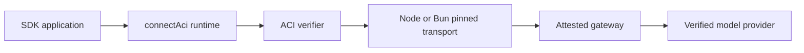

# ACI client architecture

This page describes `@phala/aci-verifier`, the only TypeScript package in this
workspace, and its relationship to the supported `pap` client. It defines
component ownership and the verification contract.

## Design goal

An ACI client verifies the remote confidential workload before sending model
request bytes. That capability belongs in a shared transport and verifier, not
inside any one SDK integration. Use [`pap`](../apps/desktop/docs/cli.md) for
coding agents and provider access.

Normal HTTPS authenticates a domain. The ACI client additionally checks which
TEE workload is behind that domain, which keys it owns, which compose was
measured at launch, and whether the connection carrying plaintext is bound to
an attested key.

## Layers

| Layer | Responsibility | Must not own |
| --- | --- | --- |
| `@phala/aci-verifier` | Quote, nonce, keyset, measurement, expiry, channel, wire-digest, receipt, and session verification | Host auth UI, model persistence, or provider branding |
| `connectAci()` runtime | One origin-scoped verified connection and fetch implementation | Global TLS state or cross-origin pins |

Applications that accept a custom `fetch` can use `connectAci()` directly. A base
URL alone cannot install an attested TLS transport, so a host without a custom
transport boundary needs a local verified proxy such as `pap serve`.

## Shared trust contract

Every supported runtime path must:

1. Fetch a fresh nonce-bound report before model traffic.
2. Verify the hardware quote and the keyset digest bound into `report_data`.
3. Verify `sha256(app_compose)` against the RTMR3 `compose-hash` event.
4. Apply any configured accepted-compose policy.
5. Reject expired keysets.
6. Validate the destination hostname and require its observed TLS SPKI to
   appear in the attested keyset.
7. Apply `aci_verified` and accepted-session constraints unless the caller
   explicitly opts out of verified provider serving.
8. Capture the exact request and response wire digests needed for receipt
   verification.
9. Verify the signed receipt and cited session before completing a response
   when the client promises automatic response verification.
10. Fail closed on every required check, including cancellation races.

The Rust and TypeScript transports differ in these details:

- The TypeScript verifier reports the quote's TCB status without enforcing it.
- When the keyset scopes TLS keys to domains, the Rust CLI accepts only the
  entry the report declares in `downstream_tls_binding`. The TypeScript runtime
  accepts any attested key for the host.
- `pap send`, `pap serve`, and the TypeScript runtime require verified serving
  by default; the TypeScript runtime applies this to JSON POST requests.
  `pap curl` sends the caller's body unchanged, so the request must carry
  `provider.aci_verified` or session IDs to fail closed at the provider hop.
- Browser APIs do not expose the peer certificate, so the browser verifier can
  check artifacts and quotes but cannot pin a channel. Use the Node or Bun
  runtime, the Rust CLI, or `pap serve` for a pinned channel.

## Response verification

Clients differ in when they verify a response receipt:

| Client | Default | Behavior |
| --- | --- | --- |
| `pap send` | Always | Verifies the receipt and cited session for its one exchange. |
| `pap curl` | Never | Pins the channel only; it does not verify a response receipt. |
| `connectAci()` | On demand | Requires an `X-Receipt-Id` on every successful POST and records the exchange. The caller runs `verifyReceipt()` when it wants the audit, so inference latency excludes the receipt fetch. |

The runtime keeps the latest 32 receipt-bearing exchanges in process memory by
default. A receipt can receive a complete audit only while its exchange is
retained.

## Runtime isolation

`connectAci()` is instance-scoped. Multiple connections can coexist
without sharing pins, connection state, credentials, or receipt history.

Node uses an undici dispatcher scoped to the connection. Bun uses its native
TLS and proxy fetch options. Conditional package exports select the adapter;
all verification and policy logic above the TLS hook is shared.

## Release acceptance

Hardware proof does not identify an approved product release by itself. What a
passing check proves, and how to choose accepted releases, is described in
[Build a verifier policy](../docs/attested-confidential-inference.md#build-a-verifier-policy).
Clients run in one of two modes:

- In **hardware-bound mode**, the client proves a genuine TDX workload owns
  the attested keys and reports its measured compose.
- In **reviewed-release mode**, the client also requires that compose hash to
  appear in a reviewed allowlist.

Rust takes reviewed hashes through repeatable `--accept-compose` flags.
TypeScript calls the same policy `acceptedComposeHashes`, and conformance tests
keep the two aligned. Pass reviewed hashes through
`connectAci({ policy: { acceptedComposeHashes: [...] } })`. With no accepted
compose hashes, the TypeScript runtime uses hardware-bound mode.

The report's `source_provenance` repository and commit are the gateway's own
statement. The compose hash is the RTMR3-bound release anchor. Load reviewed
hashes from authenticated release metadata; never copy a hash from the endpoint
and trust it on first use.

The release channel must allow a controlled overlap during rotation.
Publishing the npm package does not by itself establish a reviewed-release
claim.

Key custody is also a review decision. The Rust CLI can check the
receipt-signing key's KMS chain; the TypeScript verifier does not check
custody. See
[The privacy claim](../docs/attested-confidential-inference.md#the-privacy-claim).

## Trust boundary

The local application or coding agent sees plaintext prompts and responses.
These clients protect the remote model HTTP path. MCP servers, tools, browser
automation, shell commands, WebSockets, extensions, and host telemetry require
their own threat models.

Provider authentication is also outside ACI. SDK applications own credentials
and inject them through their HTTP client; the verifier does not maintain a
credential store.
